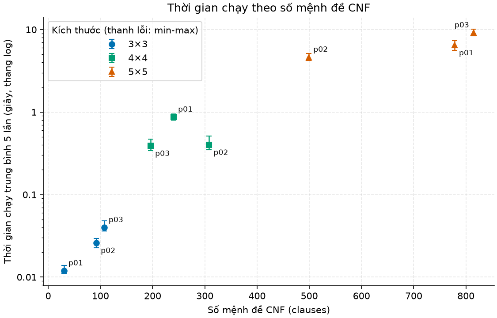
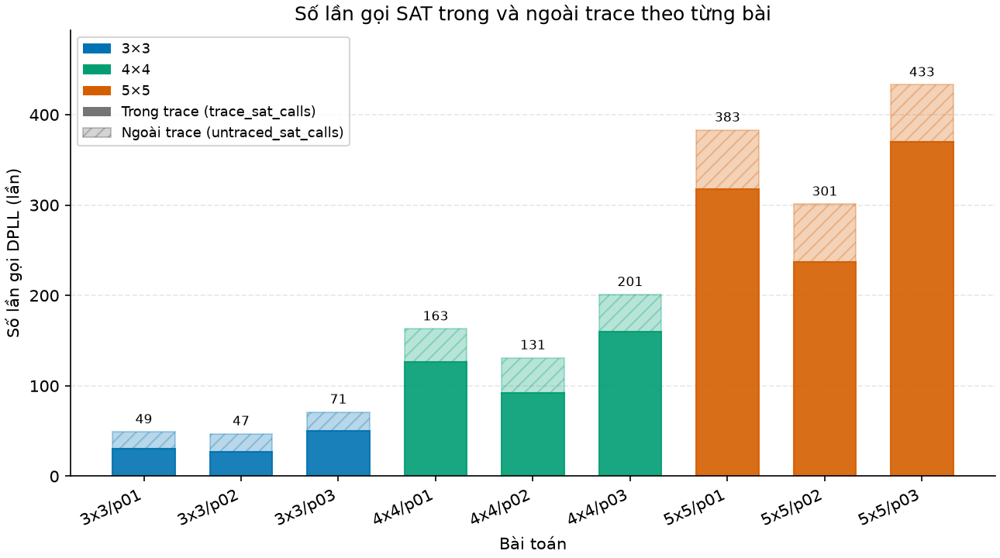
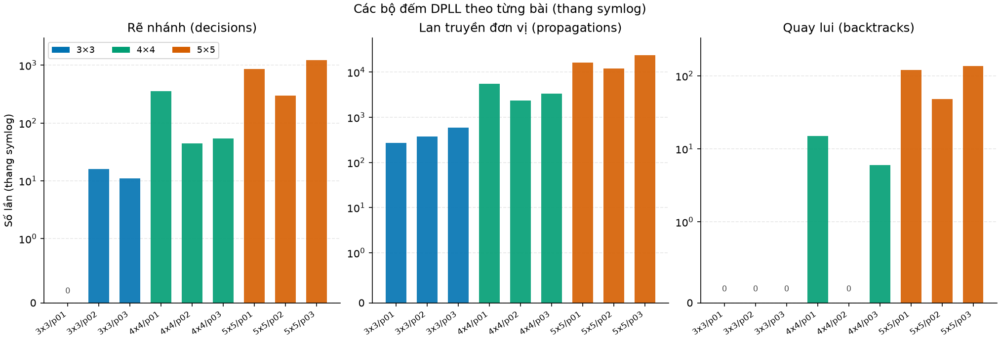

# Thực nghiệm và đánh giá

## 1. Thiết lập thực nghiệm

Tập dữ liệu đo gồm 9 puzzle chuẩn chia đều cho 3 kích thước (`puzzles_3x3/p01..p03.json`, `puzzles_4x4/p01..p03.json`, `puzzles_5x5/p01..p03.json`) và các ca lỗi cố ý trong `Source/data/`: `demo_cases/inconsistent.json` cùng 3 bài thiếu manh mối `not_found/not_found_3x3.json`, `not_found_4x4.json`, `not_found_5x5.json` (lấy từ nhánh `fix/bao-f4`, commit `bae27da`). `demo_cases/ambiguous.json` vẫn được chạy và có dòng trong `results_demo.csv`, nhưng bảng failure dùng 3 bài `not_found` cùng loại `STUCK`/`MULTIPLE` thay cho nó.

Các lệnh chạy thực hiện từ thư mục `Source/` với tham số mặc định `--timeout 30` (giới hạn 30 giây cho mỗi truy vấn DPLL):

```powershell
1..5 | ForEach-Object { python experiments/run_tests.py --out "experiments/runs/run_$_.csv" }
python experiments/run_tests.py --include-demo --out experiments/results_demo.csv
python experiments/plots.py
```

Bộ chính chạy lặp 5 lần để lấy trung bình và khoảng min-max của `runtime_sec`. Số liệu đo trên cùng mã nguồn solver với `main` (`ca27a46`), lưu tại `Source/experiments/runs/run_1..5.csv` (commit `f4e469a`) và `Source/experiments/results_demo.csv` (chạy lại sau khi thêm `not_found/`). Định nghĩa 15 cột CSV xem tại `docs/INTERFACES.md` mục 5.

## 2. Bảng kết quả

### Chi tiết từng bài (5 lần chạy)

| puzzle | size | status | unique | primary_vars | aux_vars | clauses | sat_calls | trace_sat_calls | untraced_sat_calls | decisions | propagations | backtracks | deduction_steps | runtime_mean | runtime_min | runtime_max |
| --- | --- | --- | --- | --- | --- | --- | --- | --- | --- | --- | --- | --- | --- | --- | --- | --- |
| puzzles_3x3/p01.json | 3 | SOLVED | UNIQUE | 9 | 0 | 30 | 49 | 30 | 19 | 0 | 271 | 0 | 7 | 0.012 | 0.011 | 0.014 |
| puzzles_3x3/p02.json | 3 | SOLVED | UNIQUE | 9 | 17 | 92 | 47 | 27 | 20 | 16 | 376 | 0 | 7 | 0.026 | 0.023 | 0.030 |
| puzzles_3x3/p03.json | 3 | SOLVED | UNIQUE | 9 | 18 | 107 | 71 | 50 | 21 | 11 | 586 | 0 | 8 | 0.040 | 0.036 | 0.048 |
| puzzles_4x4/p01.json | 4 | SOLVED | UNIQUE | 16 | 51 | 240 | 163 | 126 | 37 | 358 | 5527 | 15 | 14 | 0.868 | 0.795 | 0.953 |
| puzzles_4x4/p02.json | 4 | SOLVED | UNIQUE | 16 | 63 | 308 | 131 | 92 | 39 | 44 | 2331 | 0 | 14 | 0.403 | 0.348 | 0.511 |
| puzzles_4x4/p03.json | 4 | SOLVED | UNIQUE | 16 | 42 | 196 | 201 | 160 | 41 | 54 | 3322 | 6 | 15 | 0.391 | 0.343 | 0.472 |
| puzzles_5x5/p01.json | 5 | SOLVED | UNIQUE | 25 | 163 | 778 | 383 | 318 | 65 | 864 | 16139 | 121 | 24 | 6.487 | 5.606 | 7.349 |
| puzzles_5x5/p02.json | 5 | SOLVED | UNIQUE | 25 | 95 | 499 | 301 | 237 | 64 | 299 | 11881 | 48 | 24 | 4.621 | 4.242 | 5.147 |
| puzzles_5x5/p03.json | 5 | SOLVED | UNIQUE | 25 | 204 | 815 | 433 | 370 | 63 | 1224 | 23632 | 137 | 23 | 9.124 | 8.369 | 10.071 |

### Tổng hợp theo kích thước

| size | status | primary_vars | aux_vars | clauses | sat_calls | trace_sat_calls | untraced_sat_calls | decisions | propagations | backtracks | deduction_steps | runtime_mean |
| --- | --- | --- | --- | --- | --- | --- | --- | --- | --- | --- | --- | --- |
| 3x3 | SOLVED=3 | 9 (9-9) | 11.7 (0-18) | 76.3 (30-107) | 55.7 (47-71) | 35.7 (27-50) | 20 (19-21) | 9 (0-16) | 411 (271-586) | 0 (0-0) | 7.3 (7-8) | 0.026 (0.012-0.040) |
| 4x4 | SOLVED=3 | 16 (16-16) | 52 (42-63) | 248 (196-308) | 165 (131-201) | 126 (92-160) | 39 (37-41) | 152 (44-358) | 3726.7 (2331-5527) | 7 (0-15) | 14.3 (14-15) | 0.554 (0.391-0.868) |
| 5x5 | SOLVED=3 | 25 (25-25) | 154 (95-204) | 697.3 (499-815) | 372.3 (301-433) | 308.3 (237-370) | 64 (63-65) | 795.7 (299-1224) | 17217.3 (11881-23632) | 102 (48-137) | 23.7 (23-24) | 6.744 (4.621-9.124) |

Cả 9 bài chuẩn đều kết thúc với `status = SOLVED` và `unique = UNIQUE`. Toàn bộ 10 cột đếm (`primary_vars`, `aux_vars`, `clauses`, `sat_calls`, `trace_sat_calls`, `untraced_sat_calls`, `decisions`, `propagations`, `backtracks`, `deduction_steps`) cho giá trị giống hệt nhau qua 5 lần chạy.

## 3. Biểu đồ



Thời gian chạy trung bình 5 lần (`runtime_mean`, thang log kèm khoảng `runtime_min` đến `runtime_max`) tăng theo `clauses` từ nhóm `3×3` lên `4×4` và `5×5`.



Biểu đồ cột chồng tách tổng `sat_calls` thành phần `trace_sat_calls` và phần `untraced_sat_calls` cho từng bài.



Ba ô con đối chiếu trực tiếp `decisions`, `propagations` và `backtracks` của từng bài trên thang `symlog`.

## 4. Nhận xét

### Tăng trưởng `clauses` và `aux_vars`

Số `primary_vars` cố định theo diện tích lưới (`9`, `16`, `25`), còn trung bình `clauses` tăng từ `76.3` (`3×3`) lên `248` (`4×4`) rồi `697.3` (`5×5`), và trung bình `aux_vars` tăng từ `11.7` lên `52` rồi `154`. Theo `Source/logic/cnf_encoder.py`, 6 loại clue cơ bản đều có `0` biến phụ; chỉ hai clue mở rộng là `PARITY` (`m - 2` biến phụ với vùng `m >= 2` ô) và `COMPARE` (`|R|(|R|+1)/2` biến phụ mỗi vùng cho bộ đếm unary) tạo biến phụ. Vì `puzzles_3x3/p01.json` chỉ dùng clue cơ bản nên giữ `aux_vars = 0` và `clauses = 30`. Các bài có nhiều `COMPARE` tăng kích thước KB nhanh nhất: `puzzles_5x5/p03.json` có 6 clue `COMPARE` và 2 `PARITY` nên đạt `aux_vars = 204`, `clauses = 815`, còn `puzzles_5x5/p02.json` có 2 `COMPARE` và 9 `PARITY` nên cần `aux_vars = 95`, `clauses = 499`.

### Quan hệ giữa runtime, `clauses` và bộ đếm tìm kiếm

Từ `3×3` lên `5×5`, trung bình `clauses` tăng khoảng 9.1 lần (`76.3` lên `697.3`), trong khi `runtime_mean` tăng khoảng 260 lần (`0.026s` lên `0.554s` ở `4×4` và `6.744s` ở `5×5`). Runtime tăng nhanh hơn `clauses` vì cùng lúc tăng cả `sat_calls` (`55.7` lên `372.3`) và `decisions` (`9` lên `795.7`).

Trong cùng nhóm `4×4`, `puzzles_4x4/p01.json` có `clauses = 240` (nhỏ hơn `308` của `p02`) và `sat_calls = 163` (nhỏ hơn `201` của `p03`), nhưng `runtime_mean` lên tới `0.868s`, hơn gấp đôi `0.403s` của `p02` và `0.391s` của `p03`. Cột `decisions` và `backtracks` khớp với chênh lệch này: `4x4/p01` có `decisions = 358`, `backtracks = 15` và `propagations = 5527`, trong khi `4x4/p02` chỉ có `44` / `0` / `2331` và `4x4/p03` có `54` / `6` / `3322`. Ở nhóm `5×5`, thứ tự thời gian chạy cũng đi cùng chiều với `decisions` và `backtracks`: `p02` (`299`, `48`, `4.621s`) đứng trước `p01` (`864`, `121`, `6.487s`) rồi đến `p03` (`1224`, `137`, `9.124s`).

### Tỉ lệ `untraced_sat_calls / sat_calls`

Theo `Source/logic/agent.py`, `untraced_sat_calls` gồm các truy vấn ngoài `agent.trace`: lượt `GameEngine.submit_verdict` gọi `LogicAgent.classify` kiểm chứng lại mỗi bước `ACCEPTED` và một truy vấn kiểm tra `KB` ở lượt `next_forced` cuối cùng. Do `deduction_steps` tăng gần tuyến tính theo số ô úp (trung bình `7.3`, `14.3`, `23.7`), trung bình `untraced_sat_calls` tăng chậm (`20`, `39`, `64`). Trong khi đó, `trace_sat_calls` tăng nhanh hơn theo số ô còn lại cần quét qua từng bước (`35.7`, `126`, `308.3`), nên tỉ lệ `untraced_sat_calls / sat_calls` theo trung bình nhóm giảm từ `35.9%` (`3×3`) xuống `23.6%` (`4×4`) và `17.2%` (`5×5`).

### `backtracks = 0` trên toàn bộ nhóm `3×3`

Cả 3 bài `3×3` đều có `backtracks = 0` (`3x3/p01` còn có `decisions = 0`, giải hoàn toàn bằng unit propagation). Ở nhóm `4×4`, `p02` giữ `backtracks = 0` với `decisions = 44`, còn `4x4/p01`, `4x4/p03` và cả 3 bài `5×5` đều phát sinh quay lui (`6` đến `137` lần).

## 5. Failure cases

| puzzle | size | status | unique | primary_vars | aux_vars | clauses | sat_calls | trace_sat_calls | untraced_sat_calls | decisions | propagations | backtracks | deduction_steps | runtime_sec |
| --- | --- | --- | --- | --- | --- | --- | --- | --- | --- | --- | --- | --- | --- | --- |
| demo_cases/inconsistent.json | 3 | INCONSISTENT | UNSAT | 9 | 0 | 11 | 1 | 0 | 1 | 0 | 1 | 0 | 0 | 0.001 |
| not_found/not_found_3x3.json | 3 | STUCK | MULTIPLE | 9 | 0 | 50 | 15 | 0 | 15 | 24 | 30 | 0 | 0 | 0.006 |
| not_found/not_found_4x4.json | 4 | STUCK | MULTIPLE | 16 | 0 | 107 | 29 | 0 | 29 | 25 | 58 | 0 | 0 | 0.003 |
| not_found/not_found_5x5.json | 5 | STUCK | MULTIPLE | 25 | 0 | 134 | 47 | 0 | 47 | 225 | 319 | 0 | 0 | 0.039 |

Ba bài `not_found` chỉ dùng clue cơ bản và mỗi bài lật sẵn 2 ô. Với KB ban đầu, không ô nào bị ép: agent quét 1 lượt gồm 1 truy vấn kiểm tra `KB` và 2 truy vấn giả định cho mỗi ô còn úp, nên `sat_calls = 1 + 2 × (N² − 2)`, tức `15`, `29`, `47`. Agent giữ `deduction_steps = 0` và dừng ở `STUCK`. Toàn bộ clue của mỗi bài cũng có nhiều nghiệm (`unique = MULTIPLE`), nên kể cả khi mọi thẻ được lật, clue vẫn không đủ để xác định nghiệm. Trong lượt quét này DPLL vẫn rẽ nhánh để tìm model cho các truy vấn `SAT` (`decisions = 24`, `25`, `225`) nhưng không quay lui lần nào (`backtracks = 0`).

Trong `demo_cases/inconsistent.json`, hai ô mở sẵn `A1` và `B1` mang hai `FACT` trái ngược nhau về `A1` (`CRIMINAL` và `INNOCENT`). Lần kiểm tra `KB` đầu tiên trong `next_forced` trả `UNSAT` ngay ở `sat_calls = 1` (`deduction_steps = 0`), nên agent dừng với `status = INCONSISTENT` và `unique = UNSAT`.

Với `--timeout 30`, cả 9 bài chính đều `SOLVED` nên bảng trên không có dòng `TIMEOUT`. Khi một truy vấn vượt giới hạn, `DPLLSolver.solve` trả `timed_out = True` và `LogicAgent._query` ném `TimeoutError`; `run_tests.py` vẫn giữ lại dòng `TIMEOUT` kèm bộ đếm tích lũy đến lúc dừng, như đã kiểm trong `Source/tests/test_run_tests.py` (`test_timeout_zero_writes_timeout_rows_for_all_puzzles` và `test_timeout_after_accepted_step_preserves_partial_progress`).

## 6. Hạn chế

- Mỗi kích thước `3×3`, `4×4`, `5×5` mới có 3 puzzle chuẩn. Cả 4 ca thất bại trong bảng (3 bài `not_found` và `inconsistent`) đều dừng ngay từ bước 0; chưa có ca `STUCK` sau khi đã chứng minh được một số ô.
- Tất cả lần chạy thực hiện trên cùng một máy, nên `runtime_mean`, `runtime_min` và `runtime_max` chỉ dùng để so sánh giữa các bài trong cùng bộ đo.
- Cờ `--timeout` giới hạn từng truy vấn `DPLLSolver.solve` riêng lẻ thay vì tổng thời gian của một puzzle; đồng thời `runtime_sec` trong `run_tests.py` đo trọn từ lúc nạp file đến khi kết thúc `auto_solve`, bao gồm chi phí dựng lại CNF ở từng bước và các truy vấn kiểm chứng của `GameEngine.submit_verdict` (tách riêng `uniqueness_check`).
- Trong `Source/logic/cnf_encoder.py`, các clue đếm (`AT_MOST`, `AT_LEAST`, `EXACTLY`) liệt kê tổ hợp mệnh đề (`C(m, k+1)` và `C(m, m-k+1)`), còn `COMPARE` tạo `|R|(|R|+1)/2` biến phụ mỗi vùng. Với ca stress `5×5`, KB đạt tới `204` biến phụ và `815` mệnh đề, đi kèm thời gian chạy trung bình `9.124s` (`10.071s` ở lần chậm nhất).
